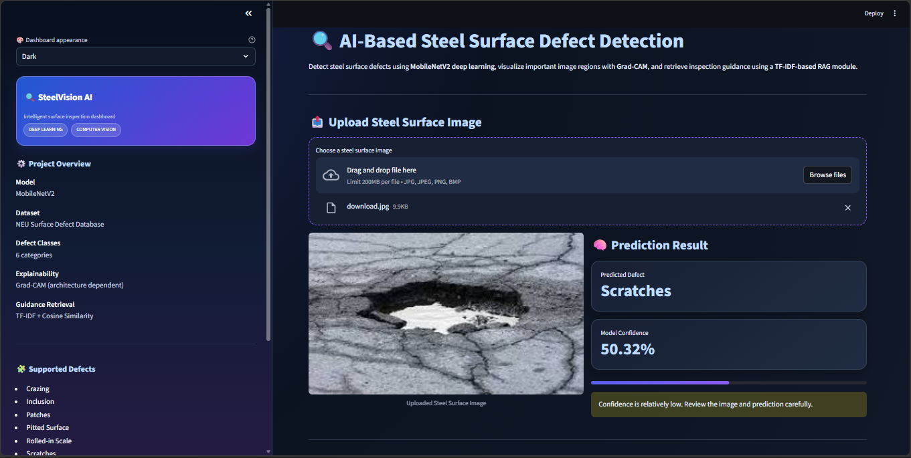

<div align="center">

# 🔬 AI-Based Steel Surface Defect Detection System

[](https://www.python.org/)
[](https://tensorflow.org/)
[](https://streamlit.io/)
[](LICENSE)

*An enterprise-grade, deep learning-driven computer vision application for automated steel surface defect classification and intelligent inspection guidance.*

</div>

---

## 📊 Dashboard Preview

> *An intuitive, interactive Streamlit dashboard providing real-time inference, batch processing, and actionable inspection guidance.*

<p align="center">
  
</p>

---

## 🚀 Project Overview

Industrial quality control in steel manufacturing requires high precision, speed, and reliability. This project implements a transfer learning pipeline using **MobileNetV2** to accurately classify steel surface micro-defects from the benchmark **NEU Surface Defect Database (NEU-DET)**. 

Beyond classification, the system features an integrated **Information Retrieval module (TF-IDF & Cosine Similarity)** to supply engineers with instant, defect-specific remediation guidelines and inspection protocols.

---

## 🌟 Key Features

- **🧠 Deep Learning Classification:** Powered by MobileNetV2 fine-tuned on the NEU-DET dataset across 6 distinct defect categories.
- **⚡ Interactive Streamlit Interface:** Real-time single image inference accompanied by confidence score breakdowns.
- **📦 Batch Processing:** Upload and process multiple inspection images simultaneously.
- **📥 Automated Reporting:** Generate and download comprehensive CSV inspection reports.
- **📚 Intelligent Knowledge Base:** TF-IDF-based contextual retrieval system delivering expert guidance for each defect type.
- **🔍 Explainable AI (XAI):** Experimental Grad-CAM visualization module *(currently under active development)*.

---

## 🏷️ Defect Categories

The model classifies steel surface anomalies into the following six standardized NEU-DET classes:

1. **Crazing** ($Cr$)
2. **Inclusion** ($In$)
3. **Patches** ($Pa$)
4. **Pitted Surface** ($PS$)
5. **Rolled-in Scale** ($RS$)
6. **Scratches** ($Sc$)

---

## 🛠️ Tech Stack & Dependencies

- **Core Language:** Python
- **Deep Learning Framework:** TensorFlow / Keras (MobileNetV2)
- **Web Interface:** Streamlit
- **Data Manipulation & Analysis:** NumPy, Pandas
- **Visualization:** Matplotlib, Seaborn
- **Information Retrieval:** Scikit-learn (TF-IDF Vectorizer, Cosine Similarity)

---

## ⚙️ Installation & Quickstart

### 1. Clone the Repository
```bash
git clone https://github.com/sweti2025/AI-Product-Defect-Detection.git
cd AI-Product-Defect-Detection
```

### 2. Install Dependencies
```bash
pip install -r requirements.txt
```

### 3. Run the Application
```bash
streamlit run app.py
```

---

## 📈 Model Evaluation & Validation

- The classification model is rigorously evaluated using **Class-wise Precision, Recall, F1-Score**, and a multi-class **Confusion Matrix**.
- *Note:* Only verified evaluation metrics are reported. Validation metrics are isolated from independent test performance to ensure unbiased evaluation.

---

## ⚠️ Project Limitations

- **Dataset Scope:** Trained and benchmarked exclusively on the NEU-DET dataset; real-world industrial noise generalization is ongoing.
- **Explainability:** Grad-CAM integration is experimental and currently in development.
- **Retrieval Engine:** Uses a predefined, curated domain knowledge base rather than a generative large language model.
- **Operational Intent:** Designed for academic demonstration, prototyping, and decision support—requires human verification prior to critical industrial action.

---

## 🔮 Future Improvements

- [ ] Complete robust **Grad-CAM** explainability heatmaps.
- [ ] Benchmark MobileNetV2 performance against **EfficientNetB0** and Vision Transformers (ViT).
- [ ] Conduct independent real-world test-set validations.
- [ ] Enhance prediction confidence calibration using temperature scaling.
- [ ] Expand the dashboard with historical model monitoring and analytics logging.

---

## 👩‍💻 Author

**Sweti Yadav**  
*B.Tech – Computer Science and Engineering (AI & ML)*  
- GitHub: [@sweti2025](https://github.com/sweti2025)

---

## 📝 License

Distributed under the MIT License. See `LICENSE` for more information.
